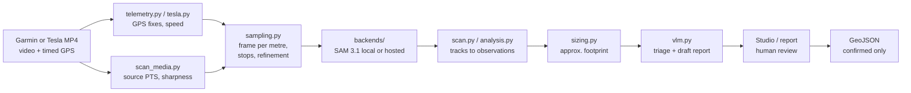
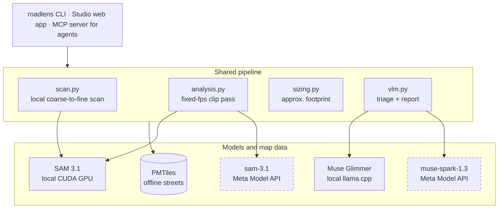
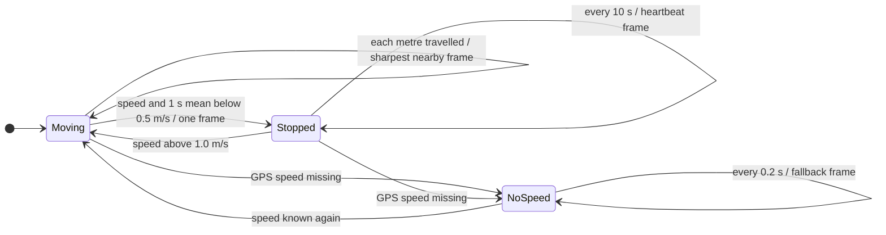
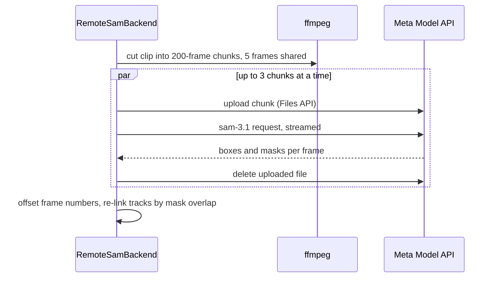
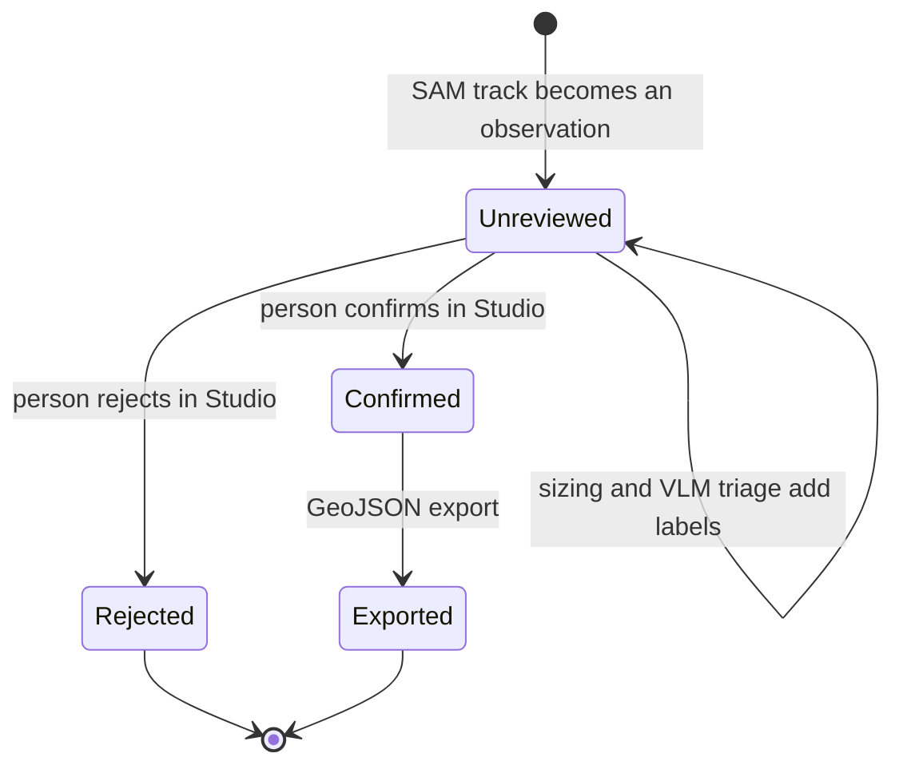

# Architecture

RoadLens turns ride footage into a short list of road-hazard candidates, each
with evidence, a camera GPS position and an approximate size, and leaves the
confirm or reject decision to a person. This page explains how the code is
organised; the [README](README.md) covers usage and results.

## Data flow

1. **Locate:** Garmin timed metadata gives GPS fixes and speed; the source
   video's presentation timestamps (PTS) give exact frame times. Nothing is
   timed from re-encoded playback.
2. **Sample:** about one sharp frame per metre of travel, one frame while
   stopped, and a denser pass from 10 m before to 15 m after each hit.
3. **Segment:** SAM 3.1 finds the text-prompted concept (default `pothole`)
   and tracks it across frames.
4. **Describe:** tracks become observations with the best evidence frame, the
   nearest camera GPS fix and a size estimate.
5. **Triage:** a VLM labels each candidate (`hazard_candidate`,
   `sealed_repair`, `surface_debris_or_stain`, `uncertain`) and drafts a
   report. Candidates stay `unreviewed`.
6. **Review:** a person confirms or rejects in Studio; only confirmed points
   are exported.

## Components

Scans, clip passes and Studio jobs all size their candidates with
`sizing.py`. Processing, street lookup and models run on the rider's machine
except the optional Meta Model API backends (dashed). The Studio and report
pages load their map and font libraries from public CDNs.

## Modules

| Module | Role |
|---|---|
| `cli.py` | `roadlens` commands: `scan`, `analyze`, `segment`, `triage`, `size`, `telemetry`, `report`, `studio`, `mcp` |
| `telemetry.py` | Reads Garmin timed GPS (adapted from Ride Studio); `read_camera_telemetry` picks Garmin or Tesla |
| `tesla.py` | Decodes Tesla dashcam SEI (per-frame GPS, speed, heading) without protobuf tooling |
| `media.py` | `ffprobe`/`ffmpeg` helpers: probe, fixed-fps clips, exact frame ranges |
| `scan_media.py` | Decodes source PTS, measures road-region sharpness, saves selected frames |
| `sampling.py` | Speed interpolation, distance sampling, stop handling, refinement windows |
| `scan.py` | Coarse-to-fine local scans, the track registry, the `scan.json` manifest and `frames.jsonl` ledger |
| `analysis.py` | Fixed-fps runs to observations; nearest-GPS lookup |
| `backends/` | `local.py` (SAM 3.1 multiplex on a CUDA GPU), `remote.py` (hosted `sam-3.1`, chunked) |
| `domain.py`, `output.py` | Detection types, mask encoding, per-frame result and overlay files |
| `sizing.py` | Flat-road camera geometry: approximate length and width of each mask, with a range |
| `vlm.py` | Local Muse Glimmer (llama.cpp) or remote OpenAI-compatible triage, and report drafting |
| `ride.py`, `pmtiles_roads.py` | Multi-clip ride index; offline street lookup from a local PMTiles archive |
| `studio.py` | Map-first web app: scope a stretch, run a job, review, export |
| `report.py` | Lightweight single-run review page |
| `mcp_server.py` | Stdio MCP server exposing the same steps to agents |

## Frame selection

`sampling.py` decides which source frames SAM sees. While moving it takes the
sharpest frame near every metre of integrated speed; the stop state keeps a
red light from costing two frames a second.

Each coarse hit then opens a refinement window from 10 m before to 15 m after
it, sampled every 0.25 m with the same stop handling. All thresholds are scan
flags; `--legacy-sampling` restores the earlier time-based rules.

## Hosted segmentation

A hosted session stops adding objects after 16, so chunking is what lets a
long stretch keep finding new potholes; a warning is printed if a chunk still
reaches the limit.

## Run directory

Every run writes a self-contained directory:

| File | Contents |
|---|---|
| `scan.json` | Manifest: settings, code revision, coverage, frame-selection reasons, timings |
| `frames.jsonl` | One line per inferred frame, including frames with no detections |
| `result-NNNNNN.json`, `frame-*.png`, `overlay-*.png` | Detections with masks, the source frame and its overlay |
| `observations.json` / `.geojson` | Candidates with times, camera GPS, score, `size_estimate`, `vlm_triage` and `review_status` |
| `summary-report.md` | Drafted report for a person to edit |

## Candidate lifecycle

No automated code path moves a candidate out of `Unreviewed`; only a person
reviewing in Studio or the report does. Triage labels are advice shown next to
the evidence.

## Design decisions

- **Unreviewed until a person says otherwise:** model output never sets
  `review_status`; the council-ready export contains confirmed candidates only
  (full-audit files are labelled as such), and nothing is
  submitted anywhere automatically.
- **Camera positions, not defect positions:** locations are labelled as the
  camera's GPS fix at the best frame.
- **Distance, not time:** sampling and refinement follow integrated speed, so
  a stop costs one frame and coverage per metre is the same at any speed
  (`docs/adaptive-sampling.md`). `--legacy-sampling` restores the time-based
  behaviour.
- **Two SAM backends, one interface:** `SegmentationBackend.segment_video`
  yields per-frame detections either way. The hosted backend uploads clips,
  deletes them afterwards, and splits long clips into 200-frame chunks
  because a hosted session stops adding objects after 16.
- **Triage sees texture, not overlays:** the VLM gets the raw frame plus an
  unmasked close-up (resized, not 1:1), because coloured masks hid the asphalt
  and misled it.
- **Sizes are estimates:** footprints come from a flat-road camera model with
  a range; depth is never estimated.
- **Local by default:** street lookup reads a local PMTiles file and models
  run locally; the optional hosted backends call the Meta Model API, and the
  Studio and report pages load map and font libraries from public CDNs.

## Further reading

- [Development log](docs/development-log.md): decisions and measurements by date
- [Adaptive sampling](docs/adaptive-sampling.md): the sampling experiments
- [Ideas to explore](docs/ideas-to-explore.md): roadmap
- [Real-time benchmarks](benchmarks/realtime/README.md): edge and hosted speed
- [Investigator skill](skills/roadlens-investigator/SKILL.md): agent workflow over MCP
