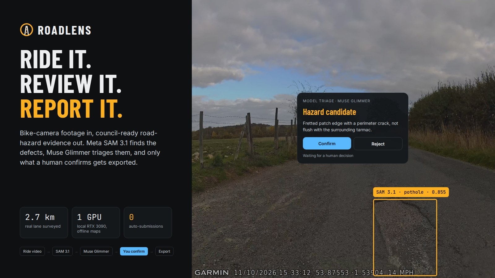
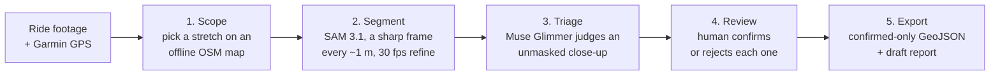
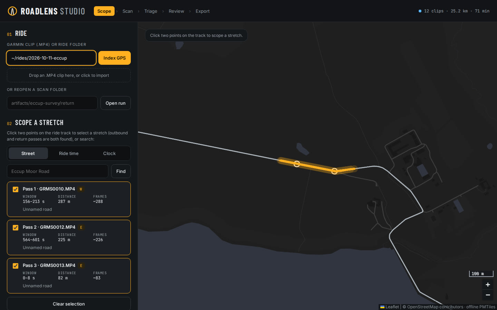
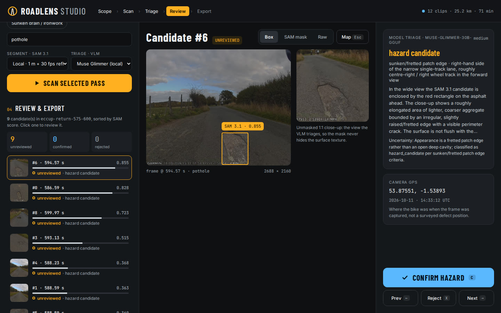

# RoadLens



RoadLens turns bike-camera footage into human-reviewed road-hazard evidence. Meta **SAM 3.1** segments candidate potholes and other hazards, **Muse Glimmer** triages each candidate, and you confirm or reject every one before anything is exported. The output is GeoJSON plus a draft report you can copy into a council or FixMyStreet submission yourself.

It is a **post-ride analysis workflow**: not a live warning system, and never an automated council spammer.

Built for the Meta Global AI Developer Hackathon, 1–4 November 2026.

## Why

Potholes are a real danger on rural lanes, and councils act on reports with clear evidence and a location. A cyclist with a bike camera already has that evidence somewhere in hours of footage, but nobody can scrub through it by hand. Fully automatic reporting is no answer either: on our footage SAM scored a harmless sealed patch at 0.808, higher than most real potholes. RoadLens uses models to cut the footage down to a short list of candidates, then leaves the decision to a person.

## How it works



1. **Scope:** index a ride folder and pick a stretch by clicking two points on the map, by street name, by ride time ("20 minutes in") or by clock time ("around 12:30"). Street lookup runs offline from a local PMTiles archive. Choose a hazard preset (pothole, cracking, debris, flooding, fallen branch, sunken ironwork) or type your own.
2. **Segment:** RoadLens integrates Garmin speed to pick one sharp frame about every metre, runs SAM 3.1 with a text prompt, then re-scans ±2 s around each hit at the native 30 fps. Every frame keeps its exact source timestamp and camera GPS fix.
3. **Triage:** Muse Glimmer 30B (local, via llama.cpp) or a remote OpenAI-compatible VLM classifies each candidate as `hazard_candidate`, `sealed_repair`, `surface_debris_or_stain` or `uncertain`. It sees the raw frame plus an unmasked 1:1 crop, because a coloured SAM mask hid the asphalt texture and misled it.
4. **Review:** in RoadLens Studio you step through candidates with the evidence, the model's verdict and the camera GPS, pressing **C** to confirm or **X** to reject. Model output never changes `review_status`; only you do.
5. **Export:** only human-confirmed candidates go into the GeoJSON. Points are labelled as camera GPS positions, not surveyed defect locations. Nothing is submitted anywhere automatically.

The same tools are exposed to AI agents through an MCP server (`roadlens mcp`) with an [investigator skill](skills/roadlens-investigator/SKILL.md), so an assistant can find "the potholes on Eccup Moor Road" for you, and still hands the confirm/reject step back to you.

## See it

| Scope a stretch and scan it | Review each candidate |
|---|---|
|  |  |

## Results on real footage

All results come from real Garmin Varia Vue footage of a rural lane near Eccup, Leeds, recorded on 11 October 2026.

- **2.7 km corridor survey, both directions:** 2,699 sampled frames plus 11,706 native-rate frames, 171 unreviewed candidate tracks. Both pothole locations reported by the rider were recovered in both travel directions ([adaptive sampling write-up](docs/adaptive-sampling.md), [data](docs/evaluation/eccup-corridor-survey.json)).
- **Distance sampling with targeted refinement** used 20–31% fewer SAM inferences than scanning every native frame.
- **Confidence alone is not enough:** a sealed asphalt patch scored 0.808, which is why RoadLens adds VLM triage and a human decision instead of raising thresholds.
- **VLM triage:** pairing the raw frame with an unmasked crop took Glimmer from mislabelling a real pothole as "blue paint" to separating pothole, sealed repair and stain correctly on all three test candidates ([development log](docs/development-log.md), [earlier Glimmer evaluation](docs/glimmer-evaluation.md)).
- **End-to-end Studio run (2 November):** a 25-second return-pass window gave 9 candidates in 6 minutes on one RTX 3090, including the known pothole at 0.828.

These are qualitative results on one road. No recall or precision figure is claimed, and pothole sizes are not measured.

## What is verified

| Component | Status |
|---|---|
| Local SAM 3.1 scan and refinement (RTX 3090) | Run on 2.7 km of real footage |
| Local Muse Glimmer 30B triage and report drafting | Run on real candidates |
| Offline street lookup and multi-clip ride indexing | Run against the full UK PMTiles archive, no network calls |
| RoadLens Studio, scope to confirmed export | Run end to end on real footage |
| MCP server and investigator skill | Unit-tested; live street and ride-time lookup smoke-tested |
| Remote Meta Model API (SAM 3.1 and VLM) | Implemented and unit-tested with mocked responses; live run pending API credits |

## Requirements

- Python 3.12, FFmpeg/FFprobe, and ExifTool.
- Local OpenStreetMap `.pmtiles` archive (Protomaps v3/v4 MVT vector tiles) for map display and offline street lookup.
- Local SAM 3.1 backend: a CUDA GPU and `sam3.1_multiplex.pt`.
- Optional local VLM backend: `llama-server` (`llama.cpp`) plus `Muse-Glimmer-30B` GGUF + multimodal projector (`ROADLENS_GLIMMER_GGUF`, `ROADLENS_GLIMMER_MMPROJ`). On a single 24 GB GPU, RoadLens runs SAM 3.1 and Muse Glimmer sequentially, releasing CUDA cache between stages.
- Optional remote backends: `MODEL_API_KEY` (SAM remote API) and `ROADLENS_VLM_API_URL` / `ROADLENS_VLM_MODEL` / `ROADLENS_VLM_API_KEY` (OpenAI-compatible multimodal VLM).

## Setup

```bash
uv sync --extra local --extra remote --extra dev
export ROADLENS_SAM_CHECKPOINT=/path/to/sam3.1_multiplex.pt
export ROADLENS_PMTILES=/path/to/united-kingdom.pmtiles
```

## Workflows

### 1. Interactive Post-Ride Studio (Recommended)

Overlay multi-clip Garmin GPS tracks on local OpenStreetMap tiles, click two points along a road fragment (or search by street name, ride offset, or wall-clock time), run targeted SAM 3.1 + VLM triage, confirm/reject candidate overlays, edit the drafted Markdown report, and export confirmed GeoJSON:

```bash
uv run roadlens studio /path/to/garmin-ride-folder \
  --pmtiles /path/to/united-kingdom.pmtiles \
  --workspace artifacts/studio
```

Open `http://127.0.0.1:8766`. You can also drag-and-drop a `.MP4` clip into the browser or open any existing `scan` / `analyze` directory for review.

### 2. Distance-Sampled Local SAM 3.1 Scan (`roadlens scan`)

Select a sharp nearby frame approximately every metre using integrated Garmin speed, retain native source resolution and presentation timestamps, and revisit `±2 s` around coarse candidates at full native frame rate:

```bash
uv run roadlens scan /path/to/GRMS0010.MP4 \
  --prompt pothole \
  --start 150 --duration 210 --spacing 1 \
  --output artifacts/eccup-distance
```

- `--prompt` accepts any text concept (default `pothole`, e.g. `"fallen tree branch"`, `"flooding"`).
- `--no-refine` runs only the coarse `~1 m` pass; `--sampling all` compares against every native frame; `--plan-only` measures distance sampling without loading SAM; `--resume` replays completed chunks from `scan.json` / `frames.jsonl`.
- One metre spacing and the default thresholds (`0.25` / `0.35`) are experimental settings, not validated optimal values; see [docs/adaptive-sampling.md](docs/adaptive-sampling.md).

### 3. VLM Candidate Triage & Draft Summary Report (`roadlens triage`)

Run local Muse Glimmer (`--vlm local`) or a remote OpenAI-compatible VLM (`--vlm remote`) over an existing scan directory to attach `vlm_triage` classifications (`hazard_candidate`, `sealed_repair`, `surface_debris_or_stain`, `uncertain`) and write `summary-report.md` while keeping `review_status: "unreviewed"`:

```bash
uv run roadlens triage artifacts/eccup-distance \
  --vlm local \
  --street-name "Eccup Moor Road"
```

### 4. Agentic MCP Server & Investigator Skill (`roadlens mcp`)

Expose RoadLens over stdio JSON-RPC (Model Context Protocol) for Muse Glimmer, Claude Code, Antigravity, or other MCP hosts:

```bash
uv run roadlens mcp \
  --workspace artifacts/mcp \
  --pmtiles /path/to/united-kingdom.pmtiles
```

Available MCP tools: `index_ride_clips`, `resolve_ride_segment` (`street`, `offset`, `clock`, `corridor`), `discover_segment_hazards_vlm`, `scan_segment_sam`, `triage_run_candidates`, and `draft_summary_report`. Companion agent instructions and guardrails live in [skills/roadlens-investigator/SKILL.md](skills/roadlens-investigator/SKILL.md).

### 5. Lower-Level Clip & Review Commands

Fixed-FPS clip pass (`local` or `remote` backend):

```bash
uv run roadlens analyze /path/to/GRMS0010.MP4 \
  --prompt pothole --backend local --start 243 --duration 10 \
  --output artifacts/eccup
```

Extract timed Garmin GPS telemetry only:

```bash
uv run roadlens telemetry /path/to/GRMS0010.MP4 \
  --output artifacts/telemetry.json
```

Serve the lightweight single-run OSM review page:

```bash
uv run roadlens report artifacts/eccup \
  --pmtiles /path/to/united-kingdom.pmtiles
```

## Checks

```bash
uv run pytest
uv run ruff check .
```

## Privacy and licensing

Source clips, ride telemetry, credentials, and generated analysis artifacts are excluded from Git. Do not commit private location data or footage containing identifiable people or vehicles.

RoadLens source code is available under the MIT License. Meta SAM 3.1 and its checkpoints are governed separately by the [SAM License](https://github.com/facebookresearch/sam3/blob/main/LICENSE). Prior-work attribution is recorded in `NOTICE`.

## Development history

Development started from an empty repository on 1 November 2026. Commit history records the implementation as it is built and validated during the hackathon. See the [development log](docs/development-log.md) for real-footage experiments, negative results, prior-work attribution, and hosted-API verification status, and [ideas to explore](docs/ideas-to-explore.md) for optional future enhancements (such as kinematic and homography-based pothole width/length estimation, and DJI and phone camera input).
