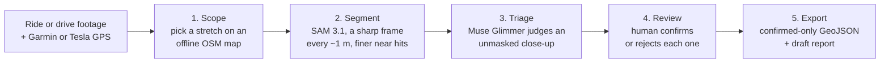

# RoadLens


RoadLens turns bike-camera and Tesla dashcam footage into human-reviewed road-hazard evidence. Meta **SAM 3.1** segments candidate potholes and other hazards, **Muse Glimmer** triages each candidate, and you confirm or reject every one before the council-ready GeoJSON is exported. The output is GeoJSON plus a draft report you can copy into a council or FixMyStreet submission yourself.

It is a **post-ride analysis workflow**: not a live warning system, and never an automated council spammer.

Built for the Meta Global AI Developer Hackathon, 1–4 November 2026.

## Why

Potholes are a real danger on rural lanes, and councils act on reports with clear evidence and a location. A cyclist with a bike camera already has that evidence somewhere in hours of footage, but nobody can scrub through it by hand. Fully automatic reporting is no answer either: on our footage SAM scored a harmless sealed patch at 0.808, higher than most real potholes. RoadLens uses models to cut the footage down to a short list of candidates, then leaves the decision to a person.

## How it works



1. **Scope:** index a ride folder and pick a stretch by clicking two points on the map, by street name, by ride time ("20 minutes in") or by clock time ("around 12:30"). Street lookup runs offline from a local PMTiles archive. Choose a hazard preset (pothole, cracking, debris, flooding, fallen branch, sunken ironwork) or type your own.
2. **Segment:** RoadLens integrates the camera's own speed (Garmin or Tesla) to pick one sharp frame about every metre, runs SAM 3.1 with a text prompt, then re-scans from 10 m before to 15 m after each hit at about one frame per 0.25 m. Every frame keeps its exact source timestamp and camera GPS fix.
3. **Triage:** Muse Glimmer 30B (local, via llama.cpp) or Muse Spark 1.3 on the Meta Model API classifies each candidate as `hazard_candidate`, `sealed_repair`, `surface_debris_or_stain` or `uncertain`. It sees the raw frame plus an unmasked close-up of the candidate, because a coloured SAM mask hid the asphalt texture and misled it.
4. **Review:** in RoadLens Studio you step through candidates with the evidence, every other detection in the same frame, the model's verdict, an approximate size and the camera GPS, pressing **C** to confirm or **X** to reject. Model output never changes `review_status`; only you do.
5. **Export:** only human-confirmed candidates go into the council-ready GeoJSON (a separately labelled full-audit download and each scan's working `observations.geojson` list every candidate, for your records only). Points are labelled as camera GPS positions, not surveyed defect locations. Nothing is submitted anywhere automatically.

The same tools are exposed to AI agents through an MCP server (`roadlens mcp`) with an [investigator skill](skills/roadlens-investigator/SKILL.md), so an assistant can find "the potholes on Eccup Moor Road" for you, and still hands the confirm/reject step back to you.

## See it

| Scope a stretch and scan it | Review each candidate |
|---|---|
|  |  |

## Results on real footage

All results come from real footage of a rural lane near Eccup, Leeds: Garmin Varia Vue bike-camera footage recorded on 11 October 2026, and Tesla dashcam footage recorded on 4 November 2026.

- **2.7 km corridor survey, both directions:** 2,699 sampled frames plus 11,706 native-rate frames, 171 unreviewed candidate tracks. Both pothole locations reported by the rider were recovered in both travel directions ([adaptive sampling write-up](docs/adaptive-sampling.md), [data](docs/evaluation/eccup-corridor-survey.json)).
- **Distance sampling with targeted refinement** used 20–31% fewer SAM inferences than scanning every native frame.
- **Confidence alone is not enough:** a sealed asphalt patch scored 0.808, which is why RoadLens adds VLM triage and a human decision instead of raising thresholds.
- **VLM triage:** pairing the raw frame with an unmasked crop took Glimmer from mislabelling a real pothole as "blue paint" to separating pothole, sealed repair and stain correctly on all three test candidates ([development log](docs/development-log.md), [earlier Glimmer evaluation](docs/glimmer-evaluation.md)).
- **End-to-end Studio run (2 November):** a 25-second return-pass window gave 9 candidates in 6 minutes on one RTX 3090, including the known pothole at 0.828.
- **Meta Model API (3 November):** hosted SAM 3.1 on a 12-second window of the same pass returned only the two rider-reported potholes (confidence 0.74 and 0.71) in 34 seconds; the local scan, with its lower threshold, had returned 8 candidates there. Muse Spark 1.3 triaged the 9 local candidates in 3 minutes, put both reported potholes in `hazard_candidate`, and agreed with local Glimmer on 7 of 9. A fully hosted Studio run scanned and triaged the whole 36-second pass in about 2 minutes, with no local GPU ([data](docs/evaluation/remote-api-eccup-2026-11-03.json)).
- **Why hosted SAM returns fewer candidates:** it is the same model with a stricter cut-off. Every hosted object scored 0.70–0.76 and matched the local candidates scoring above 0.7; the API has no threshold setting, while the local scan keeps detections from 0.25–0.35 for human review. Full resolution and frame rate added one more hosted candidate. Hosted SAM also stops adding objects after 16 per session; sending long clips as overlapping chunks took a 3-minute return-pass scan from 16 to 25 candidates, recovering the rider-reported pothole the single session had missed ([data](docs/evaluation/hazard-sweep-eccup-2026-11-03.json)).
- **Approximate size:** RoadLens projects each SAM mask onto a flat-road camera model to estimate the hazard's footprint on the road, with a range. The rider-reported pothole comes out at ≈ 60 × 15 cm from the local mask and ≈ 65 × 15 cm from hosted masks (an earlier hand-annotated estimate was ≈ 59 × 13 cm). The camera geometry was measured from the bike and independently matched, to within 1 %, by a kinematic fit of SAM tracks against Garmin speed ([data](docs/evaluation/size-estimation-eccup-2026-11-03.json)).
- **Beyond potholes:** the prompt is free text, but this footage has no other static hazard to show. On the same corridor, "standing water" and "road debris" returned nothing, "manhole cover" and "drain grate" landed on potholes under the wrong name, and "cracked asphalt" segmented the whole road ([development log](docs/development-log.md)). Every hit goes to triage and a person, whatever its label.
- **Real time, edge versus hosted:** per-frame detection runs at 2.2 fps on a Jetson AGX Orin at SAM 3's native 1008 px and 4.3 fps at 672 px with the same detections; camera resolution barely matters, because the model resizes every frame. Hosted image requests reach about 30 fps with 48 in flight, but each result is about 1 s old and costs 12.5 times as much per frame as video mode, which itself takes finished clips and runs slower than the footage. That suits slow machinery such as forklifts, tractors and robots on the edge, and live hazard logging on a bike, but not a motorway car ([development log](docs/development-log.md#real-time-limits-edge-versus-hosted), [benchmarks](benchmarks/realtime/README.md)).
- **Tesla dashcam as a second camera (4 November):** RoadLens reads the GPS and speed a Tesla writes into every dashcam frame while driving, so car footage works like the bike camera. On two passes along the same corridor, the rear camera and the repeater on the pothole's side of the car found candidates within 1–14 m of all three spots the rider photographed that day (best score per spot 0.63–0.76). Which repeater sees a pothole flips with the direction of travel, so both are scanned. Checked by eye, some masks sit on the pothole and some on a nearby patch. Sizes are not yet estimated for Tesla cameras ([development log](docs/development-log.md#tesla-on-the-eccup-corridor), [data](docs/evaluation/tesla-eccup-2026-11-04.json)).

These are qualitative results on one road. No recall or precision figure is claimed. Sizes are camera-geometry estimates of the surface footprint, not tape measurements, and depth is never estimated.

## What is verified

| Component | Status |
|---|---|
| Local SAM 3.1 scan and refinement (RTX 3090) | Run on 2.7 km of real footage |
| Local Muse Glimmer 30B triage and report drafting | Run on real candidates |
| Offline street lookup and multi-clip ride indexing | Run against the full UK PMTiles archive, no network calls |
| RoadLens Studio, scope to confirmed export | Run end to end on real footage |
| MCP server and investigator skill | Unit-tested; live street and ride-time lookup smoke-tested |
| Meta Model API: hosted SAM 3.1 and Muse Spark 1.3 triage | Run live on real footage (3 November) |
| Approximate size estimation | Run on real local and hosted masks; agrees across both and with the earlier manual estimate; not yet checked against a tape measure |
| Real-time detection, Jetson AGX Orin and hosted API | Benchmarked on 10 real frames (3 November); no live camera mode is built |
| Tesla dashcam telemetry and local scan | Run on 12 real Eccup corridor clips, rear and both repeaters (4 November); sizes not available for Tesla cameras |

## Requirements

- Python 3.12, FFmpeg/FFprobe, and ExifTool.
- Local OpenStreetMap `.pmtiles` archive (Protomaps v3/v4 MVT vector tiles) for map display and offline street lookup.
- Local SAM 3.1 backend: a CUDA GPU and `sam3.1_multiplex.pt`.
- Optional local VLM backend: `llama-server` (`llama.cpp`) plus `Muse-Glimmer-30B` GGUF + multimodal projector (`ROADLENS_GLIMMER_GGUF`, `ROADLENS_GLIMMER_MMPROJ`). On a single 24 GB GPU, RoadLens runs SAM 3.1 and Muse Glimmer sequentially, releasing CUDA cache between stages.
- Optional remote backends: `MODEL_API_KEY` for the Meta Model API (hosted `sam-3.1`, and `muse-spark-1.3` triage by default). Hosted SAM tracks at most 16 objects per session, so RoadLens sends longer clips as overlapping chunks (`ROADLENS_REMOTE_CHUNK_FRAMES`, default 200) and re-links tracks across them. `ROADLENS_VLM_API_URL` / `ROADLENS_VLM_MODEL` / `ROADLENS_VLM_API_KEY` point triage at any other OpenAI-compatible multimodal endpoint. Muse Glimmer itself is open-weights only and is not served by the Model API.

## Setup

```bash
uv sync --extra local --extra remote --extra dev
export ROADLENS_SAM_CHECKPOINT=/path/to/sam3.1_multiplex.pt
export ROADLENS_PMTILES=/path/to/united-kingdom.pmtiles
```

## Workflows

### 1. Interactive Post-Ride Studio (Recommended)

Overlay multi-clip Garmin GPS tracks on local OpenStreetMap tiles, click two points along a road fragment (or search by street name, ride offset, or wall-clock time), run targeted SAM 3.1 + VLM triage, confirm/reject candidate overlays, edit the drafted Markdown report, and export confirmed GeoJSON:

Studio indexes Garmin rides only for now; scan Tesla clips with `roadlens scan` (below) and open the output directory in Studio for review.

```bash
uv run roadlens studio /path/to/garmin-ride-folder \
  --pmtiles /path/to/united-kingdom.pmtiles \
  --workspace artifacts/studio
```

Open `http://127.0.0.1:8766`. You can also drag-and-drop a `.MP4` clip into the browser or open any existing `scan` / `analyze` directory for review.

### 2. Distance-Sampled Local SAM 3.1 Scan (`roadlens scan`)

Select a sharp nearby frame approximately every metre using integrated camera speed (Garmin or Tesla), retain native source resolution and presentation timestamps, and revisit from 10 m before to 15 m after each coarse candidate at about one frame per 0.25 m (close to native frame rate when riding). Stops cost one frame, not two a second:

```bash
uv run roadlens scan /path/to/GRMS0010.MP4 \
  --prompt pothole \
  --start 150 --duration 210 --spacing 1 \
  --output artifacts/eccup-distance
```

Tesla dashcam files work the same way: RoadLens reads the GPS and speed the car writes into every frame while it is in gear. Scan the rear camera and both side repeaters, since the repeater on the pothole's side changes with the direction of travel. `--duration` defaults to 10 s, so pass the clip length. Sizes are reported unavailable until a Tesla camera is calibrated, and rear-camera frames show the registration plate, so crop them before sharing.

```bash
uv run roadlens scan /path/to/TeslaCam/SavedClips/<event>/<time>-back.mp4 \
  --prompt pothole --duration 59 \
  --output artifacts/tesla-back
```

- `--prompt` accepts any text concept (default `pothole`, e.g. `"fallen tree branch"`, `"flooding"`).
- `--no-refine` runs only the coarse `~1 m` pass; `--sampling all` compares against every native frame; `--plan-only` measures distance sampling without loading SAM; `--resume` replays completed chunks from `scan.json` / `frames.jsonl`.
- Frame efficiency, all on by default and configurable: below `--stop-speed 0.5` m/s for `--stop-after 1` s the rider counts as stopped until `--resume-speed 1.0`, with one frame on stopping and one every `--stop-heartbeat 10` s; `--refine-mode distance` with `--refine-before 10`, `--refine-after 15` and `--refine-spacing 0.25` metres. Set `--stop-speed 0` or `--stop-heartbeat 0` to turn either part off, `--refine-mode time` for the old window of every native frame `--refine-padding` seconds either side, or `--legacy-sampling` to turn all of it off and reproduce the 1 November survey. Studio has the same switch ("Skip stops"), and the MCP scan tool takes `frame_efficient`.
- One metre spacing and the default thresholds (`0.25` / `0.35`) are experimental settings, not validated optimal values; see [docs/adaptive-sampling.md](docs/adaptive-sampling.md).

### 3. VLM Candidate Triage & Draft Summary Report (`roadlens triage`)

Run local Muse Glimmer (`--vlm local`) or a remote OpenAI-compatible VLM (`--vlm remote`) over an existing scan directory to attach `vlm_triage` classifications (`hazard_candidate`, `sealed_repair`, `surface_debris_or_stain`, `uncertain`) and write `summary-report.md` while keeping `review_status: "unreviewed"`:

```bash
uv run roadlens triage artifacts/eccup-distance \
  --vlm local \
  --street-name "Eccup Moor Road"
```

Scans size their candidates automatically. To (re)estimate sizes for an existing scan, for example with a different camera mount height:

```bash
uv run roadlens size artifacts/eccup-distance --camera-height 0.89
```

Each observation gets a `size_estimate` with the footprint along and across the road, a range, and the number of frames used. Candidates cut off by the frame edge or more than 12 m away are marked `unavailable` with a reason. The default camera geometry is the measured Garmin Varia Vue under-bar mount described in [ideas to explore](docs/ideas-to-explore.md).

### 4. Agentic MCP Server & Investigator Skill (`roadlens mcp`)

Expose RoadLens over stdio JSON-RPC (Model Context Protocol) for Muse Glimmer, Claude Code, Antigravity, or other MCP hosts:

```bash
uv run roadlens mcp \
  --workspace artifacts/mcp \
  --pmtiles /path/to/united-kingdom.pmtiles
```

Available MCP tools: `index_ride_clips`, `resolve_ride_segment` (`street`, `offset`, `clock`, `corridor`), `discover_segment_hazards_vlm`, `scan_segment_sam`, `triage_run_candidates`, and `draft_summary_report`. Companion agent instructions and guardrails live in [skills/roadlens-investigator/SKILL.md](skills/roadlens-investigator/SKILL.md).

### 5. Lower-Level Clip & Review Commands

Fixed-FPS clip pass (`local` or `remote` backend):

```bash
uv run roadlens analyze /path/to/GRMS0010.MP4 \
  --prompt pothole --backend local --start 243 --duration 10 \
  --output artifacts/eccup
```

Extract timed Garmin or Tesla GPS telemetry only:

```bash
uv run roadlens telemetry /path/to/GRMS0010.MP4 \
  --output artifacts/telemetry.json
```

Serve the lightweight single-run OSM review page:

```bash
uv run roadlens report artifacts/eccup \
  --pmtiles /path/to/united-kingdom.pmtiles
```

## Checks

```bash
uv run pytest
uv run ruff check .
```

[ARCHITECTURE.md](ARCHITECTURE.md) explains how the modules fit together, with diagrams of the pipeline, frame selection, hosted segmentation and the review lifecycle. [AGENTS.md](AGENTS.md) holds the rules for contributors and coding agents: privacy boundaries, checks and conventions.

## Privacy and licensing

Source clips, ride telemetry, credentials, and generated analysis artifacts are excluded from Git. Do not commit private location data or footage containing identifiable people or vehicles.

RoadLens source code is available under the MIT License. Meta SAM 3.1 and its checkpoints are governed separately by the [SAM License](https://github.com/facebookresearch/sam3/blob/main/LICENSE). Prior-work attribution is recorded in `NOTICE`.

## Development history

Development started from an empty repository on 1 November 2026. Commit history records the implementation as it is built and validated during the hackathon. See the [development log](docs/development-log.md) for real-footage experiments, negative results, prior-work attribution, and hosted-API verification status, and [ideas to explore](docs/ideas-to-explore.md) for optional future enhancements (such as automatic per-camera calibration, and DJI and phone camera input).
