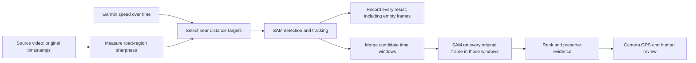

# Distance-based scanning experiment

## Decision record — 1 November 2026

The first review found that previous pothole experiments used selected stills and
short excerpts, not a complete survey of Eccup Moor Road. Three stills were chosen
using the nearest camera GPS fix to user-supplied map pins. Those pins are useful
references, not ground truth or reliable selectors of the best forward-camera view.

We will evaluate a scan independent of pothole pins, using the full road corridor
with margins. The initial hypothesis is one sample per metre of travel, selecting
a sharp nearby frame, followed by native-frame-rate examination around candidates.
One metre is an experimental default, not a measured optimum.

The nominal inference rate is speed in metres/second divided by spacing in metres.
At one-metre spacing this is about 6 fps for this cyclist, 13.4 fps at 30 mph, and
26.8 fps at 60 mph. Source frame rate limits achievable spatial coverage. We must
report gaps rather than silently claim one-metre coverage when speed is too high.

| Example speed | 0.5 m spacing | 1 m spacing | 2 m spacing |
|---|---:|---:|---:|
| 13 mph cycling | 11.6 fps | 5.8 fps | 2.9 fps |
| 30 mph driving | 26.8 fps | 13.4 fps | 6.7 fps |
| 60 mph driving | 53.6 fps | 26.8 fps | 13.4 fps |

These are required sampling rates, not model throughput or detection accuracy.
For a 30 fps source, the 0.5 m target at 60 mph is unattainable: retain all frames
and report the larger spatial gaps. There is no separate hardcoded bike/car mode.
A fixed every-Nth-frame rule would change spatial coverage with speed. A global
"sharpest frame" rule could skip road sections; quality selection stays local.

Selection must preserve source presentation timestamps: sampled-video frame index
divided by an artificial playback rate is not the original recording time. Speed
integration is approximate; stale or missing telemetry needs a logged time-based
fallback. Stationary footage needs a maximum sampling interval.

Sharpness will be measured on a road-focused image region within a limited temporal
neighbourhood. It is a blur heuristic, not a pothole detector. Candidate refinement
must include frames before detection as well as after it. Empty first-pass results
cannot establish that the road is defect-free: a full-frame comparison and manual
review remain necessary to assess missed defects.

The review also found that RoadLens's `--confidence` adjusts SAM's output filter,
while the installed multiplex builder independently sets detection filtering to
0.4 and new-object admission to 0.65. Earlier low-output-threshold experiments did
not demonstrate equivalently low internal detection thresholds.

Implementation, tests, measured timings and negative results will be recorded in
subsequent commits. Private video, telemetry and generated run artifacts stay out
of Git; published documentation will contain aggregate results and methodology.

## Implementation checkpoint

Added `roadlens scan` with these experimental defaults:

- One-metre distance targets; sharpness selection within 0.05 seconds and 0.2 m
  of the target frame. Actual selected gaps are reported, not assumed to be 1 m.
- A 0.5-second time limit at low speed, and 0.2-second fallback when speed cannot
  be interpolated across valid fixes no more than three seconds apart. Source
  frames may introduce rounding and the sharpness window may extend these gaps.
- Native resolution PNG inputs and decoded source presentation timestamps.
- 64-frame SAM sessions with 16-frame overlap, followed by native-frame passes
  within two seconds either side of first-pass detections. Overlapping refinement
  windows are merged. SAM still performs its internal input resizing.
- Output/detection/new-object thresholds of 0.25/0.25/0.35, explicitly recorded.
  These settings favour candidate discovery and may increase false positives;
  SAM's other tracking/confirmation heuristics remain enabled.
- Evidence ranking combines confidence, defect-crop sharpness, mask area and a
  penalty for touching the frame boundary. This heuristic needs human review.
- Track merging requires overlapping boxes at the same original timestamp.
  Tracks without shared-frame evidence remain separate; GPS proximity alone
  cannot prove identity. Repeated passes are not automatically deduplicated.

The frame ledger includes empty outputs. The manifest records all selected source
timestamps, estimated distance gaps, missing-speed counts, configuration, model
load time, inference time and wall time. Partial runs never receive `complete`
status. Full-frame mode uses the same machinery for a controlled comparison.

The initial 49-frame GPU trial failed with CUDA out-of-memory using SAM's upstream
16-frame grounding batch, even with 1280-pixel evidence. The next trial reduces
grounding to four frames and retains native source resolution. This is separate
from the 64-frame tracking-session length. Source-frame storage is offloaded to
CPU memory.

A further backend correction preserves propagation's revised frame-zero result.
Previously, the initial prompt output was emitted and the propagated frame-zero
output was discarded. This could discard detections established with video context.

At this implementation checkpoint, 26 tests pass and Ruff passes. Tests include
real encoded-video timestamp/extraction round trips and a fake-inference end-to-end
scan covering refinement, empty results, evidence export and overlap deduplication.
They verify plumbing, not real-world pothole recall. GPU benchmarks follow below.

## First measured comparison

On the RTX 3090, `GRMS0012.MP4` from 480–486 s contains 180 native frames
and approximately 48.1 m of travel. This diagnostic section deliberately includes
the earlier positive example; it is not an unbiased road-wide evaluation.
Both runs used native 2688×2160 evidence, the thresholds above, four-frame grounding
batches, 64-frame sessions and **eight-frame overlap** (the initial trial setting).

| Method | First-pass frames | Inferences including overlap/refinement | SAM time | Total wall time | Unreviewed tracks |
|---|---:|---:|---:|---:|---:|
| One metre + refinement | 49 | 230 | 49.3 s | 122.3 s | 7 |
| Every native frame | 180 | 204 | 43.0 s | 107.8 s | 7 |

The distance-only first pass took 11.8 s of SAM time and produced detections at
21 sampled timestamps. Its merged refinement interval covered 5.52 of the six
seconds, so the adaptive workflow performed more total work than the full-frame
run. This is an expected failure mode on densely damaged or patchy road.
Matching track counts do not establish matching defects, recall, or precision.
Visual review of the adaptive contact sheet shows several repaired/patchy regions;
these are **not seven confirmed potholes**.

A subsequent direct comparison did find that all seven selected evidence frames
had identical source timestamps, scores and masks between the two runs (mask IoU
1.0 for each matched pair). Thus the adaptive method reproduced this full-frame
baseline's chosen evidence on this one section, at higher runtime. This is model
agreement, not agreement with manually labelled potholes.

Model loading took about 12.5 s per run. Preparing native input frames took 12.3 s
for the sampled run and 36.5 s for the full-frame run. Total wall time also includes
fine-frame extraction, mask serialization and evidence export. These single runs
are illustrative, not statistically stable performance measurements.

After this comparison, PNG writing was parallelized using four workers with a
bounded eight-frame queue. This preserves native pixels while reducing serial
encoding overhead; subsequent wall times are not a controlled comparison with
these first runs. Final defaults use 16-frame overlap to provide more context
around SAM's 15-frame hot-start period. Coverage checks now reject incomplete or
duplicate backend frame output, manifests record the code revision and failure
status, and 28 tests pass.

## Road-wide scan observations (outbound complete, return running)

The outbound survey covers 150–360 s of `GRMS0010.MP4`; the return covers
420 s to the end (600.6 s) of `GRMS0012.MP4`. Both intervals include margins
around the previously identified road corridor. Neither scan accepts or uses
pothole pins for frame selection. Aggregate sanitized metrics are recorded in
`docs/evaluation/eccup-corridor-survey.json`.

### Outbound corridor (`GRMS0010.MP4`, 150–360 s) — completed

- **Coverage:** 1,381 selected coarse frames out of 6,294 native frames across
  1,380.1 m of integrated known speed (speed range 3.13–8.94 m/s, median
  7.60 m/s). Zero frames lacked speed; zero native frame intervals exceeded the
  1.0 m target; largest selected spatial gap was 1.48 m, illustrating why
  "one metre" is a target rather than a strict coverage guarantee.
- **Recovery verification:** After the initial run stalled during concurrent PNG
  export in the first fine window (`a7baa61`), `--resume` at `e1d49cb` replayed
  all 29 completed coarse chunks (1,829 inferences) directly from `frames.jsonl`
  without repeating GPU work. Reverted serial lossless PNG export completed all
  12 merged refinement windows (`fine-000`–`fine-011`, 102.5 s / 48.8% of the
  corridor, 3,060 unique native frames, 66 chunks, 3,924 inferences including
  16-frame overlap) without stalling. The exact root cause of the earlier
  thread-pool stall was not proven, and concurrent PNG export remains reverted.
- **Runtime:** Coarse SAM inference took 362.3 s; refinement SAM inference took
  802.4 s; total SAM inference was **1,164.7 s** (19.4 min) across **5,753**
  frame inferences. The resumed attempt finished in **1,696.2 s** wall time
  (28.3 min, including 68.4 s timestamp/sharpness re-measurement, 12.9 s model
  load, serial fine-window PNG export, and final overlay export; initial coarse
  preparation took 147.2 s). This confirms that native-resolution 4K coarse+fine
  scanning is a substantial offline batch job, not a near-realtime pass.
- **Unreviewed candidate tracks:** **85 unreviewed tracks**, all linked to
  `garmin_camera_gps`. Native-rate refinement supplied the highest-ranked
  evidence frame for 72 of the 85 tracks (13 retained a coarse frame). Best
  track scores ranged from 0.350 to 0.750 (median 0.405): 15 tracks scored
  `>= 0.50`, 4 scored `>= 0.65`, and 1 scored `>= 0.75`. Supporting track length
  spanned 3–128 source frames (median 15); only 1 best-evidence mask touched the
  frame boundary.

### Visual inspection of outbound candidates

All 85 outbound overlay images were inspected via local contact sheets (excluded
from Git because frames contain burned-in camera GPS coordinates):

- **Previously missed reported scenes:** Candidate `#0` (`158.46–160.43 s`, best
  frame at `160.06 s`, score `0.422`, 48,833 px across 60 frames) tracks the
  road-edge defect past the `158 s` first-reported-location still that returned
  no detection in single-image testing, selecting a closer and sharper view as
  the camera approaches. Around the `~295 s` second-reported outbound scene
  (which also returned no single-image SAM mask), candidates `#44`–`#54` segment
  multiple distressed and patched areas (`#45` score `0.672` over 103 frames;
  `#53` score `0.668` over 127 frames). Because internal detection thresholds,
  native PNG handling and multi-frame context all changed together, this does
  not isolate frame-rate coverage as the sole cause.
- **Why 85 candidate tracks are NOT 85 potholes:** Alongside localized surface
  depressions and broken road-edge troughs (such as `#77` at `334.87 s`, score
  `0.750`, and `#18` at `215.92 s`, score `0.652`), the 85 unreviewed tracks
  include:
  1. Large sealed tarmac and utility-trench repair patches (e.g., `#3`, `#14`,
     `#28`, `#31` at 533,887 px, `#84`).
  2. Surface mud, leaf litter and horse-manure clusters on the lane (e.g.,
     `#23`–`#24`, `#34`–`#36`).
  3. Fragmented tracks over heavily patched intervals (e.g., `168–170 s` and
     `332–336 s`) where SAM intermittently drops an object or crosses chunks
     without a shared-timestamp `IoU >= 0.5` match; `TrackRegistry` deliberately
     keeps these separate rather than inferring physical identity from GPS.

### Return corridor (`GRMS0012.MP4`, 420–600.6 s) — in progress

The return scan started automatically at commit `e1d49cb` immediately after
outbound completed. Its coarse plan selected 1,318 of 5,412 native frames across
1,314.0 m of integrated known speed, including 4 end-of-clip frames selected via
the 0.2 s `missing_speed_fallback` where the final 18 native frames extend past
the last embedded Garmin GPS fix. Final return timings and candidate inspection
follow upon completion.
