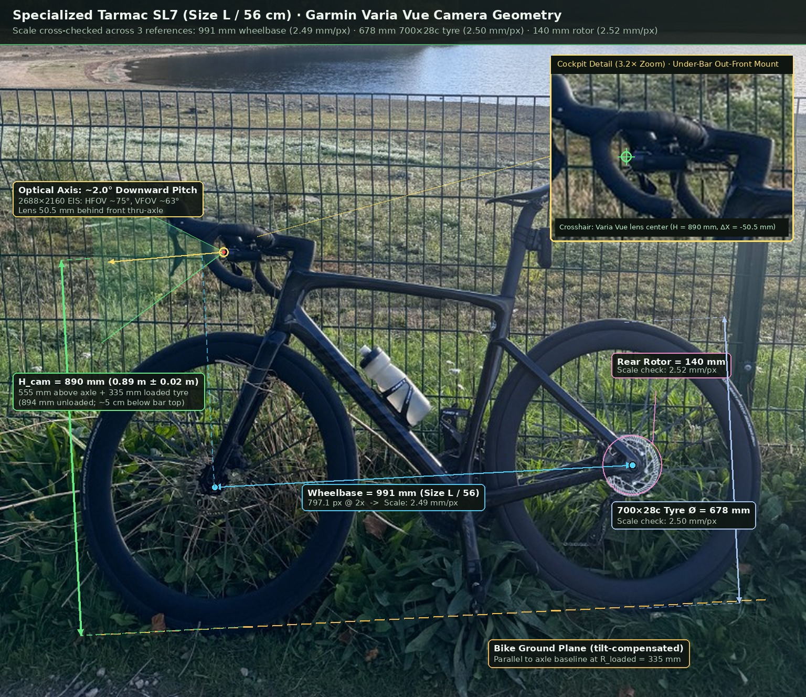
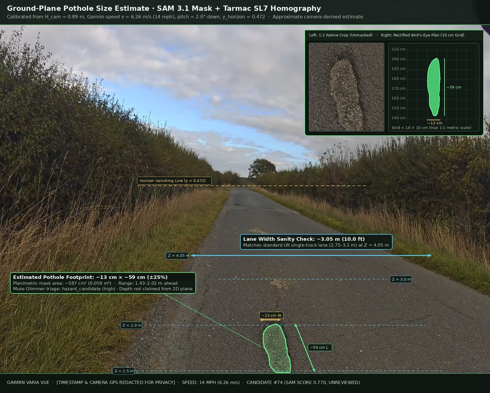
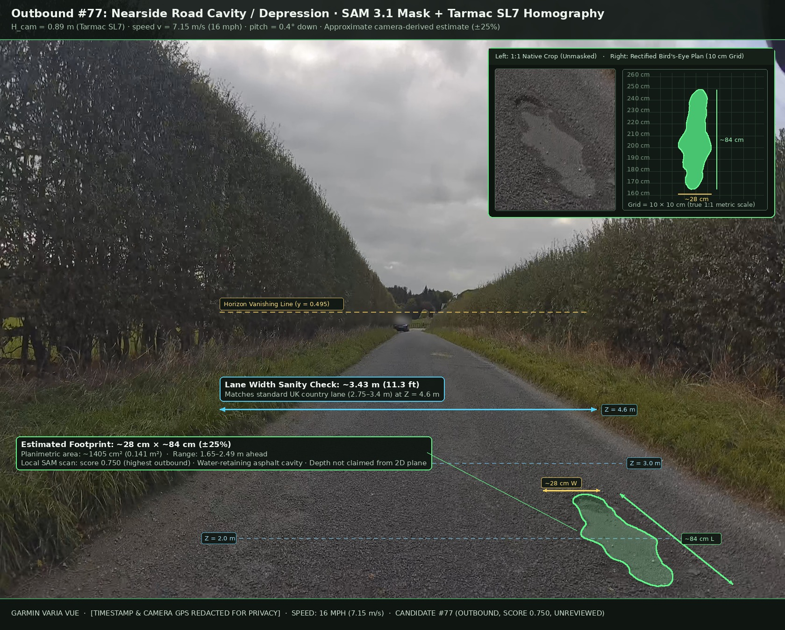
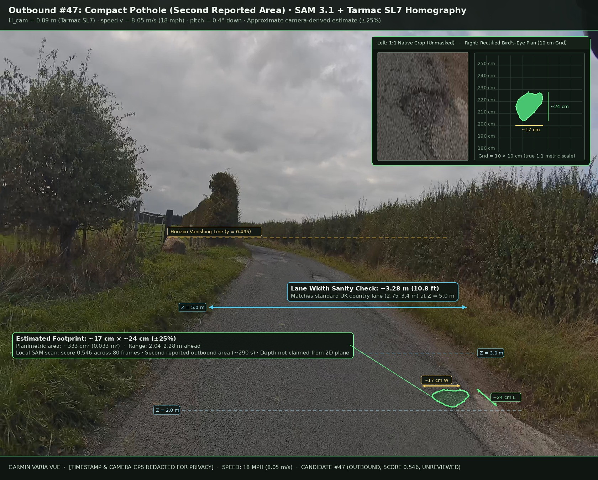
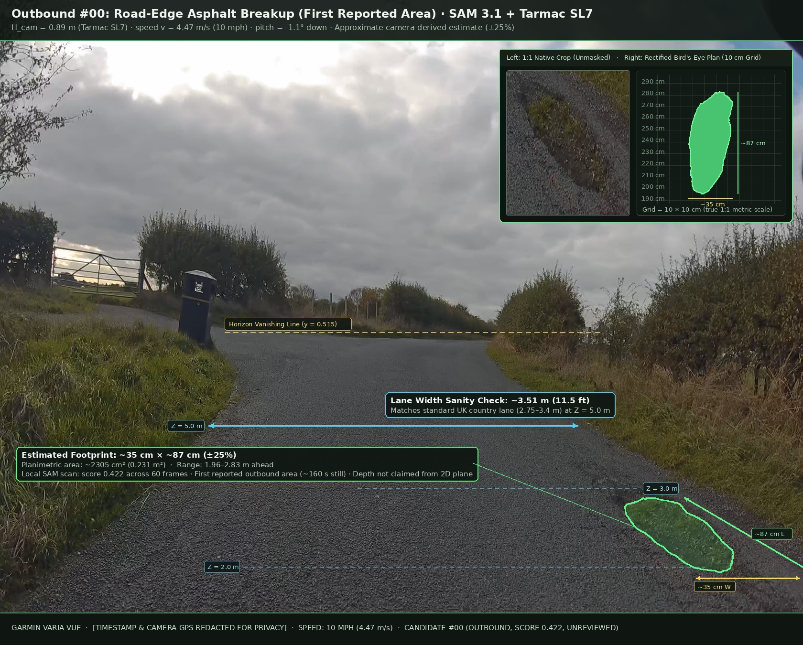
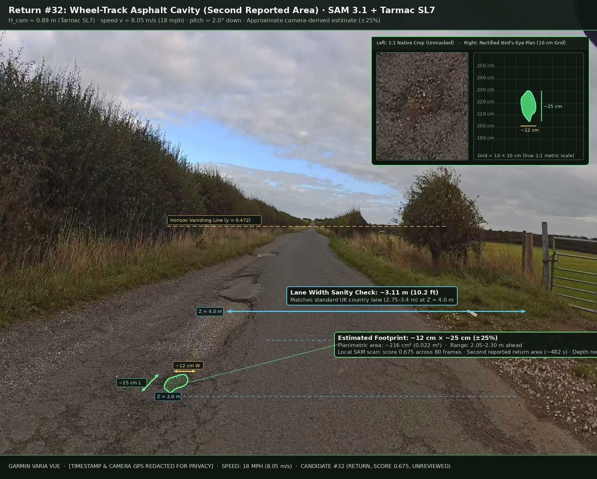
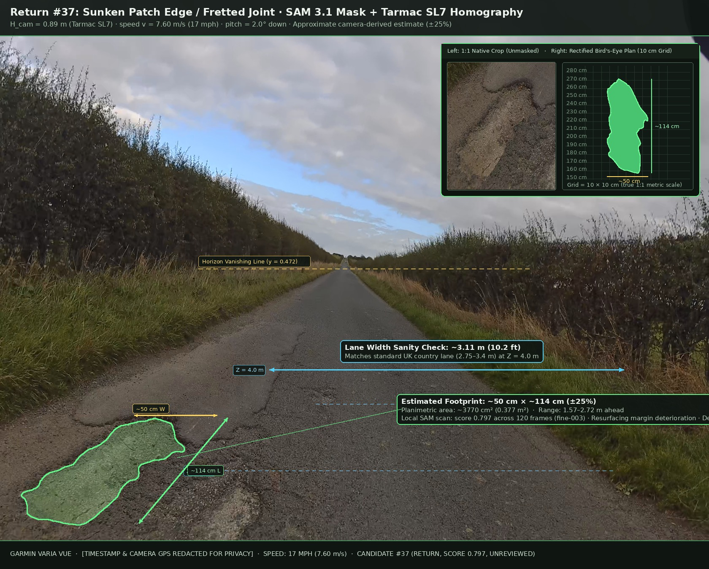

# Ideas to Explore (Nice-to-Have Backlog)

Items in this document are optional future explorations, **not** required core deliverables. Any size estimate added in future work must be explicitly labelled as an approximate camera-derived estimate with an uncertainty range, never a surveyed measurement or guaranteed millimetre depth.

## 1. Kinematic Ground-Plane Sizing from SAM 3.1 Multi-Frame Tracks + Garmin Speed

- **Status (3 November 2026):** Implemented as a calibration cross-check. `roadlens.sizing.fit_kinematic_geometry` fits the horizon and camera height × focal length from tracked mask edges and integrated Garmin speed. On hosted SAM tracks of the two reported Eccup potholes it reproduced the photogrammetric focal length below to within 1 %. Still open: running the fit automatically per ride or per camera, so new mounts calibrate themselves.
- **Priority:** Nice-to-have
- **Motivation:** During native `30 fps` refinement (`fine-*` windows in `roadlens scan`), SAM 3.1 already tracks candidate masks across `10–60+` consecutive frames while Garmin telemetry provides forward ground speed `v` (`speed_mps`).
- **Approach:**
  1. Estimate the road vanishing point (horizon pitch) over the segment from background road-plane optical flow.
  2. Combine inter-frame camera forward travel (`v * dt`, e.g. `~25 cm` per frame at `7.5 m/s` and `30 fps`) with the tracked mask's vertical motion in image space to recover local metres-per-pixel scale on the road plane without requiring a physical calibration target.
  3. Project the best-evidence SAM 3.1 mask polygon onto the local ground plane to report an approximate planimetric **width × length band** (e.g. `~35–45 cm wide × 50–65 cm long`) alongside explicit quality gates (minimum tracked frames, stable speed fix, non-boundary mask).
- **Guardrails:** Pure NumPy/OpenCV (`0 MiB` extra GPU VRAM). Do not claim millimetre cavity depth from planar ground projection; optionally pair with Muse Glimmer contextual size-band checks (`<15 cm`, `15–40 cm`, `>40 cm`) anchored against visible UK road markings (`100 mm` lines, ~`400–450 mm` ironwork) and rim/shadow severity cues.

## 2. Calibrated Ground-Plane Homography / Inverse Perspective Mapping (IPM)

- **Status (3 November 2026):** Implemented in `src/roadlens/sizing.py` with the Tarmac SL7 calibration below as the default camera. Every scan now adds a `size_estimate` (footprint along × across the road with a range) from all stored masks of a candidate, shown in Studio and quoted as approximate in draft reports. Not yet done: surface area, lens-distortion correction, and validation against a tape measure.
- **Priority:** Nice-to-have (single-frame fallback when multi-frame tracking is short or speed is unavailable)
- **Motivation:** Some detections appear cleanly in only a few frames or near stops/junctions where kinematic scale recovery is noisy.
- **Approach:**
  1. Accept an optional rider camera preset (handlebar mount height above tarmac + effective horizontal/vertical FOV) combined with auto-estimated horizon pitch.
  2. Compute a ground-plane homography mapping image coordinates `(u, v)` below the horizon to flat-road coordinates `(X, Z)` in `<1 ms` per candidate.
  3. Derive approximate width, length, and surface area (`m^2`) directly from the SAM 3.1 mask contour, reporting wider uncertainty bounds to reflect road camber, gradient, and pitching on rough tarmac.
- **Reference Bike Calibration (Specialized Tarmac SL7 Size L / 56 cm, Under-Bar Out-Front Mount):**
  - Photogrammetric scale from the `991 mm` wheelbase (`2.49 mm/px`), roughly consistent with visually measured `678 mm` `700×28c` tyre diameter and `140 mm` rear rotor (`~2.4–2.6 mm/px`, within `~5%`):
    - **Camera lens height above road (`H_cam`):** `0.89 m ± 0.02 m` (`894 mm` unloaded; `~890 mm` with `~4 mm` rider tyre sag — `555 mm` perpendicular above the axle line plus `335 mm` loaded tyre radius; ~`10 cm` lower than a naive top-of-hoods guess because of the aero stack and under-bar mount).
    - **Longitudinal lens offset:** `~0.05 m` (`5 cm`) behind the front thru-axle (`~0.39 m` behind the front tyre's leading edge).
    - **Effective `2688×2160` (`5:4` EIS-stabilized) intrinsics (cross-checked via kinematic travel `v * dt`):** `fy / height ≈ 0.81 ± 0.03` (`fx / width ≈ 0.65`, effective `HFOV ≈ 75°`, `VFOV ≈ 63°`, typical pitch `~2°` downward with horizon near `y ≈ 0.47`). Cross-checking this homography across single-track rural lane segments consistently recovered `3.05–3.51 m` carriageway widths (matching standard `2.75–3.4 m` UK country lanes).

### Annotated Demonstration Samples (Eccup Moor Road Survey)

Six representative samples illustrate the size estimation technique across distinct defect categories, scores, and travel directions (all EXIF-stripped and GPS-redacted):

1. **Return #74 — Localized Elongated Cavity (`586.59 s`, score `0.770`):**
   - Footprint: `~13 cm × ~59 cm (±25%)` (`587 cm²` planimetric area, `1.43–2.02 m` ahead).
   - Lane width check: `3.05 m (10.0 ft)` at `Z = 4.05 m`.
   

2. **Outbound #77 — Water-Retaining Road Depression / Cavity (`334.87 s`, score `0.750`):**
   - Footprint: `~28 cm × ~84 cm (±25%)` (`1,405 cm²` planimetric area, `1.65–2.49 m` ahead).
   - Lane width check: `3.43 m (11.3 ft)` at `Z = 4.6 m`.
   

3. **Outbound #47 — Compact Pothole in Second Reported Area (`290.36 s`, score `0.546`):**
   - Footprint: `~17 cm × ~24 cm (±25%)` (`333 cm²` planimetric area, `2.04–2.28 m` ahead).
   - Lane width check: `3.28 m (10.8 ft)` at `Z = 5.0 m`.
   

4. **Outbound #00 — Road-Edge Breakup in First Reported Area (`160.06 s`, score `0.422`):**
   - Footprint: `~35 cm × ~87 cm (±25%)` (`2,305 cm²` planimetric area, `1.96–2.83 m` ahead).
   - Lane width check: `3.51 m (11.5 ft)` at `Z = 5.0 m`.
   

5. **Return #32 — Compact Wheel-Track Cavity in Second Reported Area (`482.55 s`, score `0.675`):**
   - Footprint: `~12 cm × ~25 cm (±25%)` (`216 cm²` planimetric area, `2.05–2.30 m` ahead).
   - Lane width check: `3.11 m (10.2 ft)` at `Z = 4.0 m`.
   

6. **Return #37 — Sunken Patch Edge / Fretted Asphalt Joint (`489.39 s`, score `0.797`):**
   - Footprint: `~50 cm × ~114 cm (±25%)` (`3,770 cm²` planimetric area, `1.57–2.72 m` ahead).
   - Lane width check: `3.11 m (10.2 ft)` at `Z = 4.0 m`.
   

## 3. Multi-Camera Input (DJI, Phone Video, Phone Photos)

- **Priority:** Product roadmap (post-hackathon)
- **Motivation:** RoadLens currently reads only Garmin Varia Vue timed GPS. Many riders, drivers, and pedestrians record with DJI action cameras or phones. Tested readers for these formats already exist in [Ride Studio](https://github.com/pgodlews/ride-studio), the same author's MIT-licensed project that RoadLens's Garmin reader was adapted from.
- **Approach:**
  1. Replace `read_garmin_telemetry` with a camera-detecting entry point that returns the same `TelemetryResult` plus a `device` field, and generalise the `garmin_camera_gps` location label to `camera_gps`.
  2. **Phone video with timed QuickTime GPS:** port Ride Studio's `phone_telemetry.py` (ExifTool, already a RoadLens dependency).
  3. **Phone photos:** port `photo_metadata.py` for per-photo EXIF GPS and add a still-image path through Studio ("photograph a pothole while walking"); SAM 3.1 already segments single images.
  4. **DJI:** port `dji_telemetry.py` for embedded GPS and GPS SRT sidecar files, and carry its OSVplat MIT attribution into `NOTICE`.
- **Guardrails:** Most built-in phone camera apps save one location per clip rather than a timed track. Label such clips as clip-level geotags, not per-frame positions. Do not align videos with separate GPX tracks without explicit, verified clock synchronisation. Claim support only for camera families validated on real footage; Ride Studio notes that the DJI GPS-remote variant has not yet been validated against a real recording.
