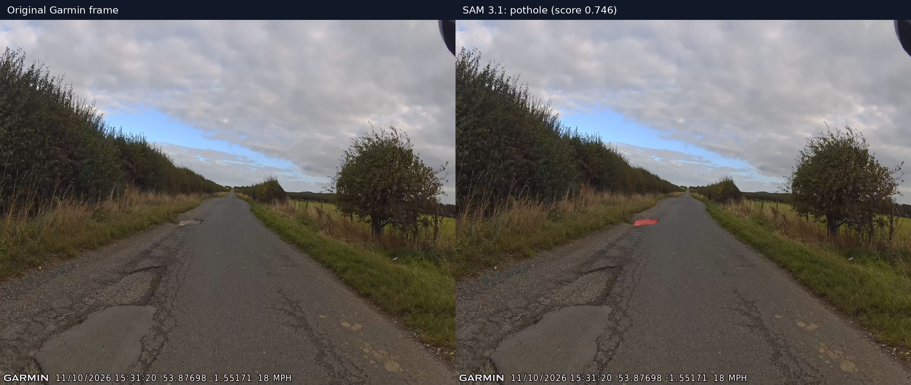

# SAM 3.1 published-image evaluation

## Method

The same six Garmin frames published in `docs/samples` and used for the Muse Glimmer evaluation were run locally through SAM 3.1 on an RTX 3090. Each frame was converted to a single-frame MP4 for the multiplex video predictor. Prompts were `pothole`, `cracking`, and `damaged asphalt`, with a 0.1 confidence threshold. All 18 image/prompt combinations completed successfully.

The raw summary is `evaluation/sam-image-results.json`. No detection was fabricated or manually added.

## Results

| Image | `pothole` | `cracking` | `damaged asphalt` |
|---|---:|---:|---:|
| Control | 0 | 0 | 0 |
| Cracking/damage | 0 | 0 | 0 |
| First reported location | 0 | 0 | 0 |
| Repair/discolouration | 0 | 0 | 0 |
| Second location, outbound | 0 | 0 | 0 |
| Second location, return | **1** | 0 | 0 |

The single detection had:

- Score: **0.7460**
- Mask area: **964 pixels**
- Normalized XYWH box: `[0.3922, 0.5447, 0.0516, 0.0195]`

The output in `evaluation/sam-second-return-pothole-mask.png` tightly covers the small mid-distance defect on the left side of the carriageway. Visual inspection confirms that this is a useful segmentation, not merely a large scene-level box.

## Comparison with Glimmer

On the same return image, Glimmer identified widespread damaged asphalt and a possible pothole with coarse boxes. SAM's positive mask was much more precise for the isolated defect. This supports evaluating a complementary workflow: Glimmer for broad candidate discovery and SAM for precise segmentation and video tracking.

SAM still returned no candidates for the other five images, including the first user-reported pothole and the visibly damaged outbound view. These experiments therefore demonstrate **one successful pothole segmentation**, not reliable general pothole detection. No accuracy or recall percentage should be inferred from 18 correlated image/prompt runs.
